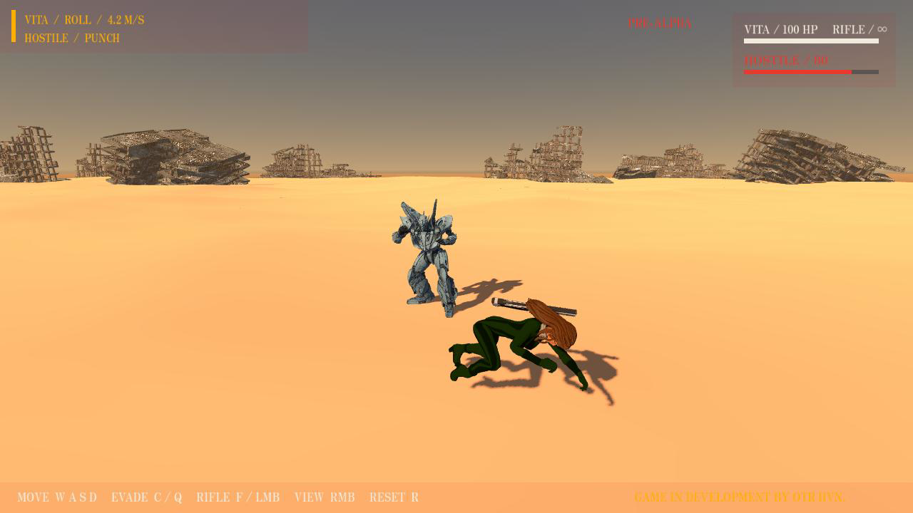

[ENGLISH](#english) · [MANDARIN 中文](#mandarin)

# YG3 Game AI

Open-source, runnable lessons on training game agents. The series begins in YG3's desert combat scene, with Vita and an animated melee enemy. Each chapter states what the agent observes, what it controls, how it learns, and how we evaluate it.

## Start here

[Chapter 01: Train a Game Combat Agent: From Scripted Policy to Neural Policy](tutorials/01-combat-agent/README.md)

Clone the repository with Git LFS enabled, install Godot 4.7.2 and Python 3, and follow the chapter's commands. The example includes desert dunes and ruined city scenery, Vita, the enemy, and the combat code. The other characters and their models are absent.

The character and enemy scenes use ordinary Godot model instances. You can replace their GLBs with your own art while retaining the same controller and policy interface. Match the required animation clips and weapon node as explained in the chapter.

Watch the same arena with the [scripted policy](media/vita-scripted.mp4) and the [neural policy](media/vita-neural.mp4). Both clips use Vita and the tutorial enemy.

## Series roadmap

1. Structured-state combat: scripted teacher, small neural policy, matched evaluation.
2. Timestamped action, event, and camera-aligned trajectories.
3. Learning from visual observations and partial visibility.
4. Memory, navigation, and longer-horizon decisions.
5. Action-conditioned world models and counterfactual evaluation.

Later chapters will be added as they are implemented and measured. Contributions are welcome; see [CONTRIBUTING.md](CONTRIBUTING.md).

## Licenses and attribution

Tutorial code and writing are MIT licensed; the [English license](LICENSE) is authoritative, with a [Mandarin reference translation](LICENSE.zh-CN.md). Included models, environment art, font, and videos have their own terms; see [ASSETS.md](ASSETS.md). YG3 maintains the tutorials. Vita, the enemy, and the desert scene are the game content used for this chapter; no other squad models or private environments are included.

Vita is © OTR HVN and may be used non-commercially with credit; commercial use requires separate permission. See [ASSETS.md](ASSETS.md) for the asset-by-asset terms.

## About YG3 and OTR HVN

YG3 builds open environments and practical AI experiments for agents, games, and embodied learning. OTR HVN develops the game that provides this chapter's desert example. As a small side note, Vita is an early character design for OTR HVN's upcoming game, a spiritual successor to *IRON ABYSS*.

---

# YG3 游戏 AI

这是一套开源、可以实际运行的游戏 AI 教程。系列从 YG3 的沙漠战斗场景开始：Vita 与一名带动画的近战敌人交手。每一章都会说明智能体能观察什么、能控制什么、怎样学习，以及如何评估结果。

## 从这里开始

[第 01 章：训练游戏战斗智能体——从脚本策略到神经网络策略](tutorials/01-combat-agent/README.md#mandarin)

克隆仓库前请启用 Git LFS，然后安装 Godot 4.7.2 和 Python 3，按章节中的命令操作。示例包含沙丘、废弃城市遗迹、Vita、敌人以及战斗代码；其他角色及其模型不在仓库中。

角色和敌人都通过普通的 Godot 模型实例加载。你可以替换成自己的 GLB 美术资源，同时保留控制器和策略接口；动画片段和武器节点的名称需要按章节说明对应起来。

观看同一场景中的[脚本策略视频](media/vita-scripted.mp4)和[神经网络策略视频](media/vita-neural.mp4)。两段视频都使用 Vita 和教程敌人。

## 系列路线图

1. 基于结构化状态的战斗：脚本教师策略、小型神经网络策略及配对评估。
2. 带时间戳的动作、事件和摄像机对齐轨迹。
3. 根据视觉观察学习，并处理视野不完整的问题。
4. 记忆、导航和更长时间跨度的决策。
5. 以动作为条件的世界模型，以及反事实评估。

后续章节会在实现并完成测量后陆续加入。欢迎参与贡献；请阅读[贡献指南](CONTRIBUTING.md#mandarin)。

## 许可与署名

教程代码和文字采用 MIT 许可证；以[英文许可证原文](LICENSE)为准，另提供[中文参考译文](LICENSE.zh-CN.md#mandarin)。模型、场景美术、字体及视频各有各的使用条款，详见[资源说明](ASSETS.md#mandarin)。本系列由 YG3 维护。本章使用的游戏内容仅包括 Vita、敌人和沙漠场景；不包含小队其他角色的模型或其他私人场景。

Vita 的版权归 OTR HVN 所有；注明 OTR HVN 后可用于非商业用途。商业使用需要另行取得许可。各项资源的条款见[资源说明](ASSETS.md#mandarin)。

## 关于 YG3 与 OTR HVN

YG3 为智能体、游戏及具身学习构建开放环境，并开展实践性的 AI 实验。OTR HVN 正在开发提供本章沙漠示例的游戏。顺带一提，Vita 是 OTR HVN 即将推出的游戏中的早期角色设计；该游戏是 *IRON ABYSS* 的精神续作。
